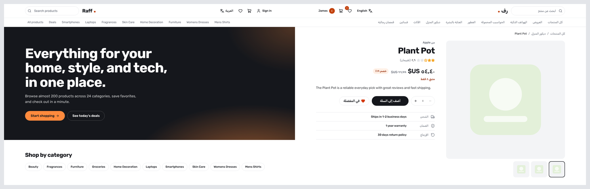

# Raff

A bilingual (English / Arabic) e-commerce store built with React and TypeScript. Products, login, and checkout run against the free [DummyJSON](https://dummyjson.com) API, and the whole interface flips to right-to-left in Arabic.



## Features

- **Catalog**: search, category filters, sorting, and pagination, all kept in the URL so every view can be shared
- **Product pages**: image gallery, stock status, discounts, shipping details, and related products
- **Cart**: quantity limits based on stock, a free-shipping threshold, and undo after removing an item
- **Checkout**: validated form (React Hook Form + Zod), pre-filled for signed-in users, with the total confirmed by the API
- **Accounts**: login with token auth, profile, and order history
- **Wishlist and reviews**: save products and post star reviews (sign-in required)
- **Admin dashboard**: KPI cards, charts with a table view, recent orders, and product add / edit / delete
- **Arabic and English**: full translation, RTL layout, Arabic plural rules, and localized numbers, prices, and dates
- **Accessible**: keyboard friendly, labelled controls, live regions for results and toasts

## Demo accounts

| Role  | Username | Password   |
| ----- | -------- | ---------- |
| Admin | emilys   | emilyspass |
| User  | jamesd   | jamesdpass |

DummyJSON simulates writes, so orders, reviews, and admin edits are kept in your browser's local storage.

## Tech stack

React 19 · TypeScript · Vite · Tailwind CSS v4 · React Router · TanStack Query · Zustand · React Hook Form · Zod · i18next · Recharts · Vitest

## Getting started

```bash
npm install
npm run dev
```

| Command           | What it does                    |
| ----------------- | ------------------------------- |
| `npm run dev`     | Start the dev server            |
| `npm run build`   | Type-check and build for production |
| `npm run preview` | Preview the production build    |
| `npm test`        | Run the unit tests              |

## Project structure

```
src/
  components/   shared UI (layout, product card, pagination, guards)
  pages/        routes, with admin pages lazy-loaded
  hooks/        TanStack Query hooks
  stores/       Zustand stores (cart, wishlist, auth, orders, reviews)
  lib/          API client, pricing, formatting, types
  i18n/         English and Arabic translations
```
